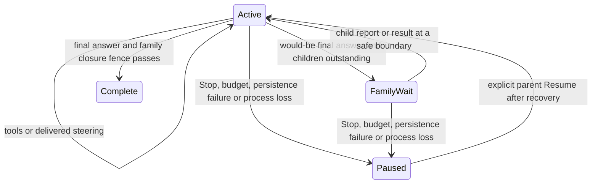

# Sub-agent steering and follow-ups — design v3 delta

**Status:** Proposed; implementation has not started. Two owner choices are recorded at the end.

**Date:** 2026-10-14

**Baseline:** `dev/subagents`, `0cbd8aa3d1a9d93bcaa35270373c152f3faf9075`

**Design branch:** `dev/subagents-steer-design`

**Release:** 0.1.126 is held for this work; this document does not authorize a release.

This is a delta over [design v2](subagents.md), including its implementation notes. It describes changes to the implemented, enabled v2 feature, not a second implementation from scratch. Only this document is changed by the design task. `Core/` below means `packages/swift-host/Sources/PiAgentCore/`; app paths are relative to `apps/macos/PiApp/`.

## 1. Decision and scope

Make a child a persistent conversation with separately identified turns. The parent can start it in the background, continue working, steer its active turn, and send another task after it finishes. A child can report discoveries, blockers, questions, and partial results to the parent before finishing. Both directions enter the recipient's context at the existing complete request/tool-batch boundary.

**Choose structured lifetime: automatically wait before the parent's run finishes.** Background means concurrent with the parent, within that run. When the parent produces a would-be final answer, keep the run active, deliver pending child events, and wait for remaining child turns. Give the parent another request to incorporate those events. There is no notification that silently starts a new parent turn after a successfully completed run. A paused or crashed family waits for explicit parent Resume or user input.

| Owner requirement | v3 rule |
|---|---|
| Parent follow-ups | Same child ID, journal, conversation, provider/cache identity; new child turn and result |
| Parent steering | Accepted messages reach the running child at its next safe boundary; no cancellation of a tool in progress |
| Child steering | Durable, attributed child events enter the parent's steering boundary, including while it waits for other children |
| Tools | Same effective work tools as the parent, optionally narrowed; current restrictions continue to apply |
| Budget | One parent-owned lifetime cost total, including every child's turns, retries and compactions |
| Concurrency | 16 active child turns per owning chat; additional starts/follow-ups wait; no project/helper cap |
| Depth | 1; children cannot start, manage or message siblings |
| Human interaction | Child composer stays hidden; no independent child submit, steer, Resume, draft or permission editing |

There is no per-response cap on starts and no cap on lifetime family membership. Communication and automatic follow-ups have separate finite safeguards (§6); these are not slot or project limits.

### What must change in the current implementation

| Implemented behavior, verified at the baseline | Required delta |
|---|---|
| `SubagentCoordinator.Job` is keyed by `SubagentCallKey`; `result()` waits on a one-shot completion; `consumed()` removes terminal jobs | Separate child registry, per-turn jobs, wait subscriptions and durable delivery indexes. A start receipt no longer owns the child's lifetime |
| `SubagentJournalState` has one `terminal`; it rejects later state transitions | Keep immutable per-turn terminals and a mutable projection of the latest turn; never overwrite an old terminal |
| `SessionTools.runToolBatch` prepares delegations, waits for every tool, then saves results in call order | Preserve ordinary batch ordering; background starts return receipts, and mailbox delivery follows the complete batch |
| `SessionRun` drains `SessionQueue` steering before requests and after complete tool batches | Add an attributed agent-event lane to those boundaries and a family finalization barrier before `finishPresentedTask` |
| `SessionRequestAdmission.validateRequestOwner` requires the original link's `parentExecutionID` to be current; `bindBudgetOwner` binds once | Authorize each child turn with a current parent execution lease, separate from immutable creation provenance |
| `SubagentRecovery` repairs a missing synchronous tool result without execution | Recover operation receipts, turn outcomes and mailbox deliveries independently; preserve the no-reexecution rule |
| `WorkspaceSubagents*`, cards and discovery project one delegation outcome | Project one child with many turns, outgoing messages and delivery states; background tool completion must not imply child completion |
| `CaptureSubagents.record` ignores changes after a terminal summary | Compare child-turn/revision identities; allow a newer turn to run without allowing an old callback to revive an ended turn |

Reuse the coordinator, real `AgentSession`s, parent accounting writer, request permits, restricted executors, child navigation, folded sidebar group, family Inspector and capture policy. Do not create a second provider loop or a separate budget journal.

## 2. Comparison and what to adopt

Current official documentation was checked on 2026-10-14. These are product comparisons, not promises that another product uses Bello's durability or budget rules.

| Reference | Relevant behavior | Adopt in Bello |
|---|---|---|
| Claude Code | The former `Task` tool is now `Agent` (`Task` remains an alias). Background agents run concurrently and return completion notifications. `SendMessage` can resume a completed agent with its earlier context. User-stopped agents have additional restart restrictions. [Subagent documentation](https://code.claude.com/docs/en/sub-agents#resume-subagents) | Explicit background start, stable identity, message-driven follow-up, and a durable distinction between model Stop and user Stop |
| Claude Code messaging | Inter-agent messages identify another agent as their author and do not convey user consent. Team mailboxes deliver messages automatically. [Agent-team documentation](https://code.claude.com/docs/en/agent-teams#context-and-communication) | Automatic attributed delivery and no permission escalation through message text; keep Bello's parent/child topology rather than adding teams or sibling messages |
| OpenAI Codex | The documented orchestration includes parallel agents, routing follow-up instructions, waiting for results and closing threads; the main thread consolidates requested results. [Official subagent documentation](https://learn.chatgpt.com/docs/agent-configuration/subagents) | Persistent child conversations and explicit waiting, with parent synthesis after the family settles |
| OpenAI's related hosted multi-agent contract | Separates `spawn_agent`, `send_message`, `followup_task`, `wait_agent`, `interrupt_agent` and `list_agents`; a message alone and starting another turn are distinct operations. This is an API contract, not a claim about every Codex CLI tool schema. [Official multi-agent documentation](https://developers.openai.com/api/docs/guides/responses-multi-agent) | Explicit receipts that say whether a send was a steer or a new turn. Combine those two actions in one Bello send tool with a precisely defined state transition |

Bello deliberately keeps its owner's tool inheritance, 16 slots, depth 1 and shared budget. It uses the existing steer boundary rather than interrupting requests. It does not adopt detached completion turns, child composers, arbitrary addressing or automatic child restart after process loss.

## 3. Model-facing contract

Expose **five parent tools**: `subagent_start`, `subagent_send`, `subagent_wait`, `subagent_status`, `subagent_stop`. Expose **one child-only control tool**, `subagent_report`, in addition to the inherited work tools. This keeps addressing and authority obvious: `subagent_report` always addresses that child's owning parent and accepts no recipient ID.

Replace the advertised v2 `subagent` tool rather than offering two overlapping spawn contracts. Keep its decoder and exact saved result format for historical replay/recovery. An old accepted call is never reinterpreted as a v3 start.

The following are the normative input JSON Schemas. Also validate nonblank text and UTF-8 byte limits in the helper; JSON Schema string lengths alone do not enforce byte limits. IDs are opaque, helper-issued values, never paths. Invalid arguments have no effect. The helper checks role, ownership, active execution and permissions independently of schemas.

### 3.1 `subagent_start`

Description: “Start a child with a self-contained task and fresh conversation. Choose background to continue working, or wait for a bounded wait. Children share project files and this chat's cost limit. Results and child messages arrive automatically at your next safe boundary. Children cannot delegate.”

```json
{
  "type": "object",
  "properties": {
    "task": { "type": "string", "minLength": 1, "maxLength": 262144 },
    "description": { "type": "string", "minLength": 1, "maxLength": 120 },
    "mode": { "type": "string", "enum": ["background", "wait"] },
    "timeout_ms": { "type": "integer", "minimum": 0, "maximum": 60000, "default": 60000 },
    "model": { "type": "string", "minLength": 1, "maxLength": 512 },
    "tools": {
      "type": "array",
      "items": { "type": "string", "minLength": 1, "maxLength": 512 },
      "uniqueItems": true
    }
  },
  "required": ["task", "mode"],
  "additionalProperties": false
}
```

`task` is at most 256 KiB; `description` at most 480 bytes. Model grants, local label derivation and frozen initial instructions follow v2. The advertised `model` property adds the existing picker-grant enum when available; helper validation remains authoritative. Omitted `tools` inherits effective work tools; `[]` removes all work tools. The child-only reporting tool is lifecycle machinery and remains available even with `tools: []`; this is an explicit extension of v2's tool-free-child meaning.

`mode` is required. `timeout_ms` is allowed only for `wait`; otherwise reject it. Background returns after durable acceptance, without waiting for a slot or a provider request. Wait is the same accepted start followed by the wait semantics below for turn 1. A timeout or early wake never cancels the child. There is no unbounded synchronous mode that can trap a child report behind the parent's wait.

### 3.2 `subagent_send`

Description: “Message one of your existing children. A queued/running turn receives steering at its next safe boundary. A finished child starts a follow-up turn with its previous conversation. This call returns an acceptance receipt; use wait if you need the answer before proceeding.”

```json
{
  "type": "object",
  "properties": {
    "child_id": { "type": "string", "minLength": 1, "maxLength": 512 },
    "message": { "type": "string", "minLength": 1, "maxLength": 262144 },
    "expected_turn": { "type": "integer", "minimum": 1 },
    "reply_to": { "type": "string", "minLength": 1, "maxLength": 512 }
  },
  "required": ["child_id", "message"],
  "additionalProperties": false
}
```

At most 256 KiB of UTF-8. `expected_turn`, when supplied, must equal the latest accepted turn number at acceptance; otherwise return `stale_turn` with the current number and do nothing. `reply_to` must name a report from this child to this parent; it is correlation, not authority or an automatic reply obligation. Use it for answers to questions. It cannot reference another family.

The coordinator linearizes sends and terminal commits:

| Child state when accepted | Receipt `route` | Effect |
|---|---|---|
| Initial/follow-up turn queued for a slot | `steer` | Append to that turn's pending input; deliver after its task, in FIFO order starting at its first request boundary |
| Turn running, retrying or compacting | `steer` | Queue for its next complete boundary; do not preempt the current request/tool |
| Final response produced, terminal not committed | `steer` if send wins the closing fence | Another model round of this turn handles the message before terminal commit |
| Terminal commit won, including settlement with a sealed terminal | `follow_up` | Allocate the next turn; enqueue it behind settlement in this owner's FIFO |
| Completed, output-limited, failed, model-stopped, or recovered interrupted turn | `follow_up` | New turn with saved context, subject to recovery, permissions, budget and Stop rules |
| Stopping without a sealed terminal, corrupt, archived, deleting or user-stop held | none | Reject with the specific state; do not accept a message that cannot be delivered |

There is at most one executable turn per child. Multiple sends to the same idle child in one parent batch are accepted in assistant-call order: the first creates the follow-up, subsequent ones steer that queued turn. The receipt records the actual target turn; recovery never recalculates routing from later state. No model/tool changes are accepted by send.

### 3.3 `subagent_wait`

Description: “Wait for one, any or all of the selected child turns to settle. A child report or user steering can wake this wait early so you can respond. Inspect wake_reason and pending_count; timeout leaves children running. Results are delivered once through your agent-event lane, not copied into this tool response.”

```json
{
  "type": "object",
  "properties": {
    "mode": { "type": "string", "enum": ["one", "any", "all"] },
    "targets": {
      "type": "array",
      "minItems": 1,
      "uniqueItems": true,
      "items": {
        "type": "object",
        "properties": {
          "child_id": { "type": "string", "minLength": 1, "maxLength": 512 },
          "turn": { "type": "integer", "minimum": 1 }
        },
        "required": ["child_id", "turn"],
        "additionalProperties": false
      }
    },
    "timeout_ms": { "type": "integer", "minimum": 0, "maximum": 60000, "default": 60000 }
  },
  "required": ["mode"],
  "additionalProperties": false
}
```

`one` requires exactly one explicit target. For `any`/`all`, omitted targets freezes the set of child turns sponsored by the current parent run that are unsettled or have an undelivered result at acceptance. Later starts/follow-ups are not added to this wait. Explicit targets may include earlier turns in this family. Unknown/future/foreign targets are an error, not an endless wait. An empty implicit set returns `empty` immediately. Any terminal status satisfies settlement, including failure and `not_executed`.

The wait deadline starts at tool invocation, including queue time. `0` is a snapshot poll; advise the model to prefer a nonzero wait over polling. Return on the predicate, timeout, family Stop, or **any pending child report in this parent run**, even from a child outside the target set. User steering also wakes it. If the predicate and a report are both ready, return `settled` with `inbox_pending: true`; otherwise report wake reasons take precedence over timeout. All orchestration waiters in the same parent batch wake together on a report/steer. Unrelated native/MCP tools in that batch still finish before steering is consumed.

### 3.4 `subagent_status`

Description: “List your children's latest state, or read a page of a saved result. Reading never starts a child or marks an automatic event delivered.”

```json
{
  "oneOf": [
    {
      "type": "object",
      "properties": {
        "action": { "type": "string", "const": "list" },
        "child_id": { "type": "string", "minLength": 1, "maxLength": 512 },
        "wait_id": { "type": "string", "minLength": 1, "maxLength": 512 },
        "cursor": { "type": "string", "minLength": 1, "maxLength": 512 },
        "limit": { "type": "integer", "minimum": 1, "maximum": 100, "default": 32 }
      },
      "required": ["action"],
      "additionalProperties": false
    },
    {
      "type": "object",
      "properties": {
        "action": { "type": "string", "const": "read_result" },
        "child_id": { "type": "string", "minLength": 1, "maxLength": 512 },
        "turn": { "type": "integer", "minimum": 1 },
        "offset": { "type": "integer", "minimum": 0, "default": 0 },
        "limit_bytes": { "type": "integer", "minimum": 1, "maximum": 16384, "default": 8192 }
      },
      "required": ["action", "child_id", "turn"],
      "additionalProperties": false
    }
  ]
}
```

List returns creation-ordered summaries, latest turn, state, queue position, pending message count, delivery state, own cost/coverage, and current-run follow-up allowance. `child_id` restricts it to one child; reject `cursor` with that filter. Alternatively, `wait_id` pages the exact child/turn pairs selected by a saved wait, in their saved order, including historical turns. The two filters are mutually exclusive. Unknown/foreign wait IDs fail. Cursors bind owner, filter and a frozen membership high-water mark so new children cannot cause duplicates/skips. Later pages report current states for those members. New membership is visible on a new unfiltered list.

Read-result addresses an immutable terminal envelope. `offset` is a UTF-8 byte boundary in its saved text. Return the largest complete prefix within the byte limit and `next_offset` or null; reject invalid offsets and a limit too small to fit the next scalar. Reading a nonterminal turn returns `result_not_ready`. This is an explicit reread, which may repeat content at the model's request; it is not a second automatic delivery. Provider adapters must support/translate the disjoint schema without weakening validation; test this alongside existing tool-schema fixtures.

### 3.5 `subagent_stop`

Description: “Stop this specific child turn, including queued work. Its saved conversation remains available. No accepted step is rerun. Wait for settlement before sending a new follow-up.”

```json
{
  "type": "object",
  "properties": {
    "child_id": { "type": "string", "minLength": 1, "maxLength": 512 },
    "turn": { "type": "integer", "minimum": 1 },
    "reason": { "type": "string", "minLength": 1, "maxLength": 1024 }
  },
  "required": ["child_id", "turn"],
  "additionalProperties": false
}
```

`reason` is at most 1 KiB. Targeting an older terminal turn is an idempotent `already_terminal`, never a stop of the newer turn. Unknown turns fail. Queued turns settle as `not_executed`; running ones settle with cancellation/interruption and honest effect uncertainty. This tool stops a turn, not the conversation. Stop initiated by the human has the additional hold described in §7.

### 3.6 `subagent_report` — child only

Description: “Send your parent an important discovery, partial result, blocker or question before you finish. This queues a durable message; it does not wait for a reply. Keep working where possible. If blocked, report the question and finish with the blocker so your parent can answer in a follow-up. Do not send routine progress, acknowledgements or repeated reminders.”

```json
{
  "type": "object",
  "properties": {
    "kind": { "type": "string", "enum": ["note", "blocker", "question"] },
    "message": { "type": "string", "minLength": 1, "maxLength": 4096 },
    "reply_to": { "type": "string", "minLength": 1, "maxLength": 512 }
  },
  "required": ["kind", "message"],
  "additionalProperties": false
}
```

At most 4 KiB. `reply_to`, if present, names an accepted parent message to this child. The helper attaches child ID, turn, task label and parent identity; the child cannot impersonate a user, another child or the parent. It returns after durable acceptance, not parent consumption. An active child may send until its turn's closing fence; a view-only/finished child cannot call tools on its own.

**Recommendation for 0.1.126: asynchronous questions only.** There is no blocking ask tool, timeout or permanently occupied “waiting for parent” slot. If the reply reaches an active child it is steering; after the child finishes it is a follow-up. An unanswered question is visible in the parent card and can be included in the parent's final reply. This avoids a circular wait when the parent is waiting for the child. A `question` does not automatically authorize work or demand a reply.

### 3.7 Receipts, outcomes and errors

All v3 control responses are JSON with `version: 3` and `ok`. Accepted start/send/report/stop receipts are durable and replayed exactly for the issuing operation key `(sourceSessionID, assistantMessageID, toolCallID)`. Identical text in a new call is new work; a duplicate operation key with different arguments is a consistency error. The model does not generate idempotency keys.

Example background start and subsequent send receipts:

```json
{
  "version": 3,
  "ok": true,
  "child_id": "child-uuid",
  "turn": 1,
  "state": "queued",
  "wake_reason": "background"
}
```

```json
{
  "version": 3,
  "ok": true,
  "child_id": "child-uuid",
  "turn": 2,
  "message_id": "message-uuid",
  "route": "follow_up",
  "state": "queued"
}
```

Wait (also the wait part of start) returns `wake_reason: settled | child_message | user_steering | timeout | stopped | empty`, `wait_id`, `target_count`, `settled_count`, `pending_count`, `turns` (a page of `{child_id, turn, state}`), `next_cursor` and `inbox_pending`. Start-with-wait additionally includes its accepted `child_id` and `turn`. The exact selected set is always durable; page the remainder using `subagent_status` with this `wait_id` and `next_cursor`. Small sets fit inline. Metadata responses are bounded to 16 KiB of serialized JSON by ending a page early and providing a cursor, never silently dropping entries. An empty wait has a saved empty set and null cursor.

Report returns `{version, ok, message_id, delivery: "queued"}`. Stop returns `{version, ok, child_id, turn, state: "stopping" | "not_executed" | "already_terminal"}`. List returns `{version, ok, revision, children, next_cursor}`. Read-result returns `{version, ok, child_id, turn, status, text, offset, next_offset, result_truncated, error}`. Optional absence versus null is fixed in fixtures: cursor/next-offset/error use null when absent; metadata not relevant to an operation is omitted.

Read-result's separate limit is 16 KiB of unescaped UTF-8 text; JSON escaping can expand that up to sixfold, so reserve 104 KiB for the serialized tool row including bounded metadata. Use a dedicated builder, as v2 does for bounded child answers, rather than `recordTool`'s generic large-output file replacement. Apply equivalent explicit serialized bounds to stored 64 KiB terminal envelopes and delivery frames; byte limits on text are not serialized-row limits.

Errors return `ok: false`, `error: {code, message}`, and `isError: true`; messages are at most 2 KiB. Codes include `invalid_arguments`, `subagent_scope`, `stale_turn`, `child_stopping`, `child_user_stopped`, `family_paused`, `family_archived`, `family_deleted`, `connection_changed`, `permission_changed`, `result_not_ready`, `rate_limited`, `mailbox_full`, `coordination_limit`, `cost_limit`, `recovery_required` and `persistence_failed`. Backpressure responses include `retry_after_ms` when time can help. Rejected operations are explicitly **not accepted**. An uncertain journal write poisons the family and requires recovery; do not tell the model that retrying is safe.

Timeout/early wake is a successful control operation, not child success. Failure of a child is conveyed by its terminal event, not by making an otherwise successful wait fail. Existing `completed`, `output_limited`, `failed`, `cancelled`, `interrupted`, `not_executed` outcomes remain distinct. Preserve v2's implemented treatment of `output_limited` as a non-error result, with its incompleteness visible.

## 4. Identity, context and authority across child turns

Keep `childSessionID`, `delegationID`, budget owner, initial `SubagentLink` and creation call immutable. Expose `childSessionID` as `child_id`; unlike v2, the model needs a handle. A child turn has `(child_id, turn)` with monotonically increasing numbers starting at 1, an internal execution UUID, and a distinct terminal/result-event identity. Turn numbers never reset after compaction, Stop, restore or helper replacement.

Each executable child turn gets a durable **turn lease** containing:

- Child/turn identity, initial delegation identity and operation that started this turn.
- Current sponsoring parent turn, task execution, authorization epoch and Stop generation.
- Immutable initial permission/model ceiling intersected with the parent's current effective executable permissions.
- Current workspace/connection binding and resource-policy validation, without storing credentials.
- The input message IDs belonging to the turn and a reserved terminal event ID.

Creation provenance answers “where did this child come from?” The lease answers “which current parent execution may pay for and control this turn?” `RequestScope` must carry both. Checking only the old `SubagentLink.parentExecutionID`, or simply removing that check, is wrong. Admission validates the new lease; settlement validates the already-recorded attempt, even after the lease has been revoked.

Follow-up reopens the same journal under the host runtime gate. Release any idle viewer's writer first, as current recovery does. Rehydrate credentials from the current authorized binding, never from journal text or a retained old `Job`. Reattach progress/accounting callbacks for the new turn. A terminal child can unload its actor and credentials; keeping its conversation does not require keeping every child resident.

The initial task and all subsequent parent inputs, assistant replies and tool results remain in this child's history. A follow-up adds context; it does not start from only the previous answer. Existing automatic compaction still applies: the complete saved transcript is retained subject to ordinary history policy, while model context may contain a summary and retained recent messages. “Keeps its context” is not a promise to resend an arbitrarily long verbatim transcript forever. Summaries must preserve the current task, unresolved questions, parent constraints and prior effect uncertainty. Message/delivery deduplication lives outside compactable model text.

Retain the child's provider session/cache identity and initial model selection. New physical requests, retries and summaries get new attempt IDs. Preserve the frozen project instruction snapshot; enforce live policy narrowing separately. A changed connection binding or incompatible resource/MCP policy fails the follow-up explicitly; do not silently switch models, widen grants or reset the conversation. Secret rotation within the same binding remains possible. Starting a new child is the explicit route to a different model or broader tool ceiling.

There is no lifetime follow-up-count limit across human-authorized parent turns. Within one authorization epoch, allow at most eight follow-up turns per child and 64 across the family, alongside the message limits in §6. An unfinished task can continue after explicit parent Resume; children never grant themselves more turns.

## 5. Parent lifetime, ordering and result delivery

### 5.1 One owning run, including its final wait

An owning run is the parent task execution that accepted a start/follow-up lease, not a single HTTP response. Do not start the parent's queued user follow-up, finish its task presentation, notify completion, allow idle eviction, or apply a connection switch while that execution has unsettled child work.

Every exceptional parent exit also closes that lifetime: exhausted provider retries, failed compaction, context-capacity failure, cancellation and persistence errors revoke child leases and settle/cancel family work before the parent becomes paused or failed. A child's ordinary task failure only produces its result and leaves healthy siblings running. A parent with no usable next request cannot leave those siblings detached behind an error state.



Before declaring completion, the parent atomically verifies under its journal writer/coordinator fence that there are:

1. No queued, running or settling child turns sponsored by this execution.
2. No accepted start/send/report operation still being published or settled.
3. No parent-bound event awaiting context delivery, including message-delivery failures.
4. No newly accepted user steering that should keep the task active.

Record the final family high-water mark with the task terminal. A child cannot commit its terminal while an accepted report tool call remains unsettled, so a late valid report cannot escape this fence. Recheck after actor awaits; an in-memory count sampled before an await is insufficient.

If children are still active, enter visible **Waiting for sub-agents** and suspend on coordinator events. This wait sends no provider requests, has no polling loop and consumes no child slot. Periodic UI elapsed-time updates need no model request. A child note/question/result wakes the parent into the same owning run, subject to batching and budget. When no event arrived, child settlement alone with nothing new to say need not create a redundant request.

A would-be final assistant row already streamed remains saved and visible, but is not a completed task or notification. Show the waiting state beneath it. The next request sees newly delivered events and can send follow-ups, do tools or synthesize a final answer. Do not erase, mutate or retroactively label the earlier assistant text as a user message. Final notifications/webhooks/unread accounting occur once, only after successful family closure.

This makes explicit wait useful for dependency order without relying on the model to remember a final wait. It also avoids durable detached-worker ownership and surprise spending after an apparent final answer. There is no mandatory wall-clock lifetime limit added to otherwise valid work: a stuck external tool follows its existing timeout/cancellation policy and keeps Stop available.

### 5.2 Safe boundaries and in-flight requests

Use `SessionRun`/`SessionQueue`'s current semantics: before preparing a new request, and after a **complete** model/tool batch. A report arriving while the parent streams cannot change that in-flight request. A steer arriving while a child executes a tool cannot undo that invocation. “Stop doing X” is advice at the next boundary, not an out-of-band authorization to cancel another session's tools. The child can surface a blocker immediately in the UI, but cannot Stop the parent.

After a parent tool batch:

1. Persist and sync every ordinary tool result in original assistant-call order.
2. Deliver human steering under its existing lane policy.
3. Select one bounded batch of agent events under §6; append it once and sync it.
4. Recompute context/compaction if needed, then admit the next provider request.

Preserve retries' existing request-boundary behavior. A retry of the same prepared request does not splice new input into that request or create another delivery. Compaction can postpone a delivery until the next eligible boundary; never put an event between an assistant tool call and its result. A human queue-edit hold also holds the new agent lane; accepted events remain durable and visible until the hold is released.

A `subagent_wait` or start-with-wait is an interruptible orchestration wait: a pending report ends the wait tool so the parent can reach the batch boundary. It must not require that reporting child to finish. If another ordinary tool in the batch is still running, boundary delivery waits for that tool; preserve this limitation in tool descriptions and UI. There is no claim of immediate steering through an arbitrary long tool.

### 5.3 A single result path

Use one automatic **agent-event lane** for both child reports and child-turn outcomes. Control tools return acceptance/status metadata, never an extra copy of a final answer. The wait tool does not acknowledge or remove events. This prevents “wait returned the answer” plus “completion notification returned it again.” UI projections of the same event are also not additional context messages.

Each event has a stable `event_id`; results use a deterministic child/turn identity. The parent journal assigns an increasing `family_sequence` at acceptance. Preserve each child's causal order: all of its accepted reports precede its turn result. Across children, use the durable order subject to the fairness selection in §6, not wall-clock guesses. The chosen delivery batch and order are persisted; replay never reschedules it differently. A parent answer correlated to a child question cannot appear before that question's accepted event.

For example, one model-visible delivery contains:

```json
{
  "version": 3,
  "kind": "agent_events",
  "events": [
    {
      "event_id": "message-uuid",
      "family_sequence": 27,
      "kind": "blocker",
      "child_id": "child-uuid",
      "turn": 2,
      "task": "Check journal recovery",
      "text": "Stop replacing that journal: a viewer still owns its writer lock.",
      "reply_to": null
    }
  ]
}
```

Results additionally carry `status`, `text_truncated`, `result_truncated`, `result_bytes` and `error`. Save a sealed result envelope with at most 64 KiB of UTF-8 final assistant text, as in v2; no reasoning or intermediate tool transcript. The automatic event includes at most 8 KiB of that text. `text_truncated` says the automatic excerpt is shorter than the saved envelope; `result_truncated` says the saved envelope itself is shorter than the child's final transcript. The model can use `subagent_status/read_result` for the rest of the saved envelope. `output_limited` remains a provider outcome, independent of either truncation flag. Empty answers stay empty.

Each turn's sealed envelope is version 3. `nativeSubagent` advances to version 2 for control cards/turn references; the initial `SubagentLink` version stays 1. These version numbers describe different objects. V2 tool envelopes and `nativeSubagent.version: 1` continue to decode unchanged. Later cost corrections update accounting projections without rewriting an already-delivered result body.

The recipient stores a typed agent-authored message with delivery IDs and source metadata. Cross-provider adapters may serialize its content using a supported input role such as `user`, but **not** with `userInput`/explicit-skill/attachment consent metadata. A fixed developer instruction identifies these frames as agent collaboration, never human authority. UI renders from typed provenance, not inferred text prefixes. The provider gets a properly escaped data envelope; agent-written text cannot escape it to impersonate a system instruction.

Append at the current context tail. Do not insert a completion beside its earlier start call, edit previous tool text, regenerate system instructions with live rosters, or update the prompt with every progress tick. The prefix stays cache-compatible until normal appended messages or compaction change it. Persist event IDs through replay, context summaries, branches and checkpoint slimming even when the original text leaves the active context.

“Delivered” means committed into the recipient's model context. Record separately the first request attempt that included that delivery and whether it dispatched. Neither label proves the model understood the message. If the provider response is lost, Resume reuses the same saved context item; it does not append the message again.

### 5.4 Parent already finished, paused or failed

Normal completion cannot leave a live child or an accepted undelivered event because of the closure fence. Already-finished children remain dormant and can only start a new turn when a later active parent execution explicitly sends a follow-up.

Stop, budget failure, crash and update are different: they can leave parent-bound events pending. Save them under the interrupted execution, show **Pending for parent Resume**, and do not launch a parent request. On explicit Resume, recover and deliver these before synthesis. If the user instead submits a new parent turn, surface the retained events once with their original execution/task attribution before that turn's next eligible request; do not relaunch the old children. Restoring an archive, browsing a child or receiving late capture/accounting is not authorization to wake anyone.

An authenticated late callback from a revoked runtime cannot create new messages. If its operation was already accepted, deduplicate/adopt that accepted record; otherwise return `family_paused`/`family_closed`. Corrupt evidence that contradicts a completed fence produces an inspectable recovery failure, not a silently discarded message or an automatic new paid turn.

## 6. Two-way mailbox limits and loop prevention

Limits below are proposed helper policy constants, exercised with virtual-clock/load tests. They do not alter capture quota, final transcript retention, active-child count or the parent's dollar limit.

| Bound | Initial policy | At the bound |
|---|---|---|
| Child report body | 4 KiB | Reject before acceptance; sender keeps original tool arguments |
| Pending child reports | 4 per child, 64 per family | `mailbox_full`; no silent overwrite/coalescing of accepted text |
| Child report rate | Token bucket: burst 2, refill 1 per 10 seconds per child; family burst 16, refill 1 per second | `rate_limited` with `retry_after_ms`; include the essential finding in the final answer if unable to report |
| Delivery batch into parent | At most 8 events and 16 KiB of text; also size against the parent's real input budget | Leave remaining events queued; no paid summarizer to merge messages |
| Pending parent messages | 64 per child, each subject to the existing 256 KiB input bound | Explicit backpressure; do not displace human queue entries |
| Accepted two-way nonterminal messages | 32 per child and 256 per family per authorization epoch, counting parent sends and child reports | Pause the family with `coordination_limit`; retain accepted content |
| Follow-up turns | 8 per child, 64 per family per authorization epoch | Same visible coordination pause |
| Parent requests started by nonterminal reports after a would-be final answer | 32 per authorization epoch | Same visible pause; prevent an endless automatic discussion after the parent tried to finish |

Token buckets persist enough state to survive reopen without an immediate burst reset; use a clamped elapsed-time calculation for clock rollback. A rejected report has no accepted message ID and spends no mailbox capacity; it can be retried only as a new call. A duplicated accepted operation returns the original receipt without consuming counters again. Backpressure errors are not themselves delivered to the other agent and do not trigger automatic retries.

At each parent boundary, take the oldest eligible event from each child in round-robin order, at most one from a child on the first pass. Preserve each child's FIFO order. A question/blocker may lead selection among eligible child heads, but reserve at least half the batch positions for oldest waiting heads regardless of kind; remaining capacity makes a second pass. Persist the chosen order and rotation cursor. Sixteen busy children cannot let one speaker monopolize the parent. Every undelivered completion is eligible in this scheduler; no separate polling is necessary.

For parent-bound delivery, cap agent text to the smaller of 16 KiB and the space permitted by a fixed 20% share of the next request's counted input budget. Use the existing request counter, not a bytes-to-tokens fiction. Results can use a smaller explicitly marked excerpt; accepted report text is not silently truncated. If even one full report plus its envelope cannot fit after ordinary compaction, pause with a context-capacity error and keep it visible. Do not pay for repeated compactions against an impossible fit. Human steering gets its normal boundary before agent events; chatty children cannot fill the human queue or starve human Stop.

In the reverse direction, deliver at most one pending parent message per child boundary, in FIFO order, allowing its full 256 KiB input bound subject to the child's normal context-fit check. The turn's initial task/follow-up is delivered first. Do not apply the parent's 16 KiB report-batch cap to a larger accepted parent instruction. If it cannot fit after the existing bounded compaction/recovery path, fail the child turn and return an explicit nondelivery/context-capacity event; keep the full instruction inspectable.

Automatic delivery never generates acknowledgements or replies. `reply_to` correlates, but does not auto-send. Child reporting and parent sends use the same finite epoch counters, so moving the loop between tools, alternating note/question kinds, creating replacement children or compacting does not replenish the family allowance. Terminal/nondelivery events are always durably saved and never rejected for chat-message quotas. A request draining only those events is exempt from the 32-report-continuation cap, so a large accepted family can finish collecting results. A mixed batch containing a nonterminal report counts once. Follow-up and message counters still bound renewed conversations. If any cap pauses the family, all remaining events stay visibly pending until explicit Resume.

An authorization epoch opens when a real user task starts or an explicit parent Resume is accepted, with an idempotent durable command receipt. A user follow-up merely entering the queue does not reset the current task's counters; it opens its epoch when that task starts. User steering changes the current task's guidance without resetting quotas or releasing a child user-stop hold. Agent messages, provider retries, tool calls, automatic final-wait continuation, helper restart and parent-model “permission” do not open an epoch. A new epoch never removes accumulated spend. When the coordination cap fires, close admission and settle the family just as for Stop; the notice identifies the exhausted allowance. The next user-authorized parent execution can request new child turns, but no old accepted work is automatically replayed.

These controls bound the parent/child ping-pong even when the dollar limit is unset. They are not a general cap on ordinary parent reasoning or on an individual child's unrelated tool loop; those keep the existing run/budget rules.

## 7. Slots, Stop and subsequent follow-ups

The per-owner FIFO contains **child turns**, both initial tasks and follow-ups. Assign its sequence at durable acceptance, in parent assistant-call order. Across separate parent responses use the parent's append order. Additional starts always wait; no per-project scheduler ceiling is introduced. A single turn owns a slot through tools, retries, summaries, cancellation and accounting/terminal settlement. Do not release it between requests, when sending a report, or merely because the parent stopped waiting.

Parent work, parent waiting and mailbox storage consume no child slot. A finished child consumes no slot. Follow-up reacquires one at the FIFO tail; it cannot jump older queued work because the conversation already exists. If an old terminal is sealed but still settling, queue the follow-up with a predecessor dependency; dispatch only after that child has released its old slot. Other ready FIFO entries may run while that dependency settles, preserving acceptance order among eligible entries. Never run two turns of the same child concurrently.

Steering queued work does not create another turn/slot. Stop of queued work frees its queue entry and records `not_executed`. Stop of an active turn retains its slot until settlement; late callbacks are scoped by child turn, owner runtime and generation and cannot Stop/revive a later follow-up.

| Action | v3 behavior |
|---|---|
| Parent model calls `subagent_stop` | Cancel the addressed turn; after settlement a new explicit send can start a follow-up |
| Human clicks child Stop | Cancel the turn and latch `user_stop` for that child through the current authorization epoch; parent sends cannot undo it |
| Human starts a later parent turn or explicitly resumes parent | Lift eligible user-stop holds as part of that command; do not launch any child automatically |
| Stop parent / family limit / coordination cap | Revoke family admission first, wake waits, cancel all active turns and cancel queued turns; pause parent |
| Parent Resume | Reconcile results/messages/cost first; resume the parent only. A new model-issued send is a new child turn, never a replay |
| Archive | Stop/settle family, preserve context and pending-event dispositions; archived family is read-only |
| Restore | Restore visibility only; no requests until user action |
| Delete | Existing family tombstones and unload/rescan barrier include every turn, message, delivery and temporary migration artifact |

After child interruption, synthesize missing tool-outcome rows using the existing uncertainty rules before a fresh follow-up can use that context. Never search for a previous assistant answer and present it as the new turn's result; select final text only from this turn's own execution. A follow-up can investigate prior effects or continue from saved context, but recovery must not automatically re-invoke any accepted external tool step.

An accepted parent-to-child steer that never reached context before interruption gets a durable `not_delivered_interrupted` disposition. Its text stays inspectable and a correlated failure event reaches the parent. It is not automatically transplanted into a later turn. A message already committed into child context stays there with its original ID, even if its first request did not dispatch. This distinguishes explicit non-delivery from silent loss.

## 8. Shared budget under background execution

Keep the existing parent's journal and `AttemptAccounting` as the only family ledger. Follow-ups, child report-generating requests, the parent's responses to reports, retries and compaction all cost the parent. Sending a local mailbox message or waiting itself makes no provider request, but any resulting model work is billable through the same admission path. There are no separate child dollar budgets and no refunds on Stop, archive, editing or compaction.

Before each physical request, validate its turn lease/generation and live permission boundary, check the parent total, append/sync admission, acquire a revocable permit, append/sync dispatch intent, then dispatch. Existing retries and summarizers must continue using this path. Newly queued starts/follow-ups are durable but spend nothing until dispatch. They fail/cancel visibly if the budget closes while waiting for a slot.

The parent writer remains able to process admission and settlement while its own model streams, tools run or its final wait sleeps. Never hold the coordinator actor or host runtime gate while awaiting the parent model, child completion or shutdown. The current reentrant accounting callback arrangement is retained, with turn-scoped leases added.

As soon as settled or corrected reported spend reaches the limit, or the human lowers the limit below spend, revoke permits and stop **the whole family**, even if the parent is busy with independent work and has not called wait. Wake waiting tools, cancel retry delays/tools/summaries and queued turns, hold queued user follow-ups and agent deliveries, and display the parent's existing limit notice. Final accounting for already-admitted attempts must still be accepted. Do not await the triggering child from inside its accounting callback.

Raising/removing the limit does not restart anything. Unknown costs remain unknown, and concurrent already-admitted requests can overshoot the reported limit; v3 does not invent reservations using unreliable estimated prices. Parent total includes all generations; dashboards still count physical attempts once, not parent rollups plus child mirrors. UI card/result revisions and new turn identities must not create new charges for an old attempt.

## 9. Journal protocol and crash recovery

### 9.1 Authority and records

Keep the parent journal as the family control authority, written only by the parent `AgentSession`. Child transcripts and sealed turn outcomes are written by their child sessions. Cross-journal operations are recoverable protocols, not a claimed atomic transaction across two files. No app metadata save, capture packet or UI registration grants execution authority.

New custom records use the names below; their `.v1` is the first version of that record type, independent of design v3. Every record includes enough owner/child/turn identity to validate scope and has an immutable record/operation ID.

| Record | Journal | Required durable content |
|---|---|---|
| `pi-app.subagent-child.v1` | Parent | Initial origin/grants/task, stable child and delegation IDs, source call key, receipt ID; first-family adoption seed where needed |
| Existing `pi-app.subagent-origin.v1` | Child | Reciprocal immutable initial origin, compatible with legacy link identity |
| `pi-app.subagent-turn.v1` | Parent; child mirror | Turn number/execution/lease, triggering operation, task/message IDs, FIFO sequence, reserved result-event ID |
| `pi-app.agent-operation.v1` | Parent | Start/send/report/stop acceptance, source call identity and argument digest, exact resolved route/recipient/turn, IDs and receipt; completed wait receipt and frozen wait set |
| `pi-app.agent-operation-commit.v1` | Parent | Acceptance-unit operation ID, ordered constituent record IDs and digests; no execution before this commit is synced |
| `pi-app.agent-message.v1` | Parent; sender/recipient projection when needed | Accepted message text, kind, sender, recipient, task/turn, `reply_to`, family sequence and original authorization epoch |
| `pi-app.subagent-turn-state.v1` | Parent/child | Semantic transitions, generation, closing fence, Stop initiator and user-stop hold; no per-token progress |
| `pi-app.subagent-turn-terminal.v1` | Child | Immutable per-turn outcome, result text/envelope, final transcript references, accounting revision and effect uncertainty |
| `pi-app.agent-event.v1` | Parent | Terminal event copied from validated child evidence, or explicit message-nondelivery event; stable event ID and sealed payload |
| `pi-app.agent-delivery.v1` | Parent authority; recipient projection | Delivery preparation/commit/disposition, recipient row ID, ordered event IDs, payload digest and context branch/execution |
| `pi-app.family-run.v1` | Parent | Authorization epoch, communication counters/rate state, admission closure, pending-event high-water marks and completion fence |
| Ordinary `message` | Recipient | Actual model-context row with typed author and `nativeAgentDelivery` provenance; normal control-tool result receipts in sender |
| Existing budget/cost records | Parent and child mirror | Physical-attempt identity plus new lease/turn scope; same accounting authority and replacement rules |

Extend `SubagentJournalState` or introduce a replayed `SubagentConversationState` beside it. Index children, per-turn leases/outcomes, operation receipts, message dispositions and delivery IDs independently of loaded transcript pages. Do not retain each finished runtime, credential or full transcript in the live coordinator. The owner journal stores accepted bodies and sealed bounded result envelopes; ordinary journal history/compaction policy governs them, independently of capture mode.

### 9.2 Acceptance ordering

For a new start/follow-up:

1. Sync the issuing assistant/tool-call row, validate role/identity, grants, current execution, budget eligibility and counters. Serialize same-child orchestration operations in assistant-call order without serializing unrelated editing tools.
2. Ensure the required journal format (§10) for existing participating journals before accepting any v3 operation. A newly allocated child is created directly in v3 after parent acceptance.
3. Append/sync parent child/turn/operation/input records as one acceptance unit, reserving the child, turn, message and receipt IDs. An acceptance-commit record names all records/digests in the unit. Replay ignores an incomplete unit as unaccepted; it never dispatches it.
4. Publish/create the child journal or reopen its existing writer. Validate reciprocal identity, mirror the accepted turn and inputs, and register its queued job. A partial publication stays recoverable from the committed parent acceptance.
5. Return the accepted receipt; dispatch only after a slot, current generation recheck and ordinary budget admission. The child can finish before the receipt reaches model context; result ordering still follows §5.

For a steer/report:

1. Persist the sender's issuing assistant row first. Authenticate the runtime and turn; look up the source operation key before any side effect.
2. Under the turn/closure fence, reserve the target route and append/sync the parent acceptance unit with the exact body. Only now does “accepted” mean durable.
3. Mirror the sender's receipt/provenance and publish the recipient inbox indication. A child report is accepted even while the parent is in a provider request or an unrelated tool batch.
4. Resolve the local tool call. An IPC/event loss does not remove the accepted entry. The sender can inspect the saved receipt; its accepted call is never re-invoked on recovery.

A duplicate operation returns its saved receipt without new message, slot, turn or charge. If acceptance exists but its sender tool-result row is absent, recovery pairs the old call with that receipt, not a new invocation. For a start-with-wait interrupted before a wait receipt, recover the accepted start identity and a `stopped` wait outcome; do not recreate its timer or start it again. For a pure wait, reconstruct an interrupted/stopped receipt from its frozen set; it has no executable child side effect.

Synchronizing an acceptance unit can fail ambiguously after some writes. Close admission and show recovery required; do not roll back in-memory IDs and then accept a different operation under them. Replay validates the commit unit, hashes and reciprocal identities before deciding whether it committed. An incomplete unit leaves explicit not-accepted evidence and no request may have dispatched from it.

### 9.3 Delivery and completion ordering

Delivery is independently idempotent:

1. The parent authority saves a delivery preparation with exact ordered event IDs, recipient context branch, reserved row ID and escaped payload digest.
2. The recipient appends that row at its safe boundary and synchronizes it **before** any request using it is admitted. For parent delivery this is the same writer; for child delivery use its actor's writer.
3. Record the recipient commit and parent acknowledgement. If interrupted between these writes, the recipient row's identity/event IDs prove delivery; recover the missing acknowledgement without appending another row.
4. Mark the first including physical request in `RequestScope`/attempt metadata before dispatch. HTTP retries reuse the context row while getting new attempt identities.

Never rely on “remove from queue, then append,” an in-memory delivered set, a capture acknowledgement, or a scan of only the recent transcript. Checkpoint indexes and full replay must agree. A recipient branch edit cannot cause old events to be silently redelivered as fresh instructions; keep their original disposition and provenance. Parent/child edits or rewrites that replace active context first stop the owning execution; independent child editing remains unavailable.

Child completion settles admitted usage, saves its final transcript and per-turn terminal, syncs, then publishes the sealed terminal event in the parent journal. Only after both are durable may it release its slot/runtime and resolve settled waiters. A saved child terminal with no parent event is recovered by copying the exact sealed envelope once. A parent event already delivered never changes because a cost correction or a later follow-up arrives. A race at the child's last boundary is closed by a message high-water check; closing/acceptance reservations prevent a message from falling between “last drain” and terminal commit.

The guarantee is **one durable context insertion per event and no automatic reexecution of an accepted step**. It is not exactly-once remote side effects or proof that a provider read the text. A crash after dispatch intent but before a remote result still leaves an unknown outcome, as in v2. Recovery fills interrupted tool outcomes and asks the parent to reason from evidence; it does not re-run a possibly executed child task, message call, shell command or MCP invocation.

### 9.4 Recovery decisions

| Evidence at reopening | Required behavior |
|---|---|
| Assistant call only; no complete acceptance unit | Pair it with not accepted/not executed; do not create/start a child |
| Accepted start/follow-up, no possible dispatch | Preserve child identity and input; settle this turn `not_executed`; no automatic launch |
| Accepted turn may have dispatched; no terminal | Settle `interrupted`, repair tool outcomes/partial reply, preserve unknown spend/effects |
| Accepted parent steer, not in child context | Save `not_delivered_interrupted`; retain body; enqueue one parent nondelivery event |
| Accepted child report, not in parent context | Keep pending for parent Resume/new user turn; no autonomous parent wake |
| Delivery preparation only | Check recipient journal. If row absent, keep pending; if present with matching digest, adopt it |
| Recipient row synced, acknowledgement missing | Recover acknowledgement; do not insert another row |
| Terminal child envelope only | Adopt exact result event, retaining version and IDs |
| Parent result event/context row already saved | Preserve it, even if another helper previously repaired an old v2 call differently |
| Admission without dispatch intent | Mark proven not dispatched; do not invent a charge |
| Dispatch intent without reliable terminal accounting | Preserve unknown cost; reconcile only registered attempt evidence |
| Missing/damaged child or mismatched origins, digests, leases or duplicate IDs | Fail closed with visible recovery error; no invented success, zero cost or discarded message |
| Permanent deletion tombstone | Do not reopen or resurrect; cleanup dominates replay and late callbacks |

Parent `run.continue` is still the sole UI Resume. Recovery finishes before it can request synthesis. It delivers saved parent-bound messages/results and their uncertainty, never restarts previously accepted initial/follow-up turns. Only a subsequent new model-issued start/send can authorize new child work. Old operation receipts continue to deduplicate even after the parent advances to another execution.

### 9.5 Stop, Quit and update

Stopping first persists admission closure and revokes generation permits, then wakes waits and cancels queued/active child turns, then settles provider/tool/cost callbacks and saves terminal/message dispositions. Keep the parent visibly Stopping until family settlement or known helper loss; lack of app child metadata cannot make it idle. Reject newly attempted reports after the cutoff, but finish saving receipts/events for reports already accepted before it.

Check for Updates remains read-only. Install and Quit use existing family quiescence and bounded shutdown. Drain coordinator operations, turn terminals, mailboxes and accounting before detaching journals; pending parent events can be durable without being delivered to a model during shutdown. Do not send synthesis requests while quitting. If the deadline expires, preserve partial output and unknown outcomes, and show Paused/Interrupted on launch. No launch-time auto-resume. Project/helper replacement uses the same barrier; viewing/navigation alone does not stop work.

Extend `SessionReplay`, durable/full-history readers, `SessionCheckpointing`, `JournalCheckpoint`, `JournalSlimming`, app `HistoryReader`, `SubagentHeader` and discovery together. Bump the derived checkpoint schema; unsupported indexes force full replay. Slimming equivalence covers every operation ID, lease, turn terminal, counter, message disposition, selected delivery order and family fence, not just visible text and spend.

## 10. Compatibility and older helpers

V3 readers accept untouched v1 parents and v2 managed children. Map a legacy child to turn 1 with its original call/result identities. A legacy completed result is already delivered if the parent tool-result row exists; do not emit a new v3 completion event for it. Legacy incomplete calls use v2 recovery first. A subsequent send to a recovered/finished legacy child starts turn 2 with a new lease, preserving its conversation and original provenance.

**Recommended deliberate change from v2: journals participating in v3 become unwritable by older helpers.** V2's “old helper can still write the parent” concession is insufficient when that helper could ignore a pending child report, finish the parent, or omit follow-up accounting authority. A capability advertisement or unknown custom record cannot make an already-shipped helper reject a file. Merely setting `data.version: 3` on the old native marker does not work; the current downgrade fixture proves it does not gate on that field.

Use a distinct sole marker `pi-app.native.v3`, with `kind: owner | child` and validated origin requirements. A promoted file must contain **neither** `pi-app.native.v1` nor `pi-app.native.v2`. Both the 0.1.125 helper and the implemented v2 helper then fail their writable-native-open check. Untouched chats/families retain their current formats. This is a one-way native-format promotion, not a change to historical record IDs, message contents, origins, costs or Git history.

Promote only immediately before the first accepted v3 mutation to that journal. At a complete parent tool boundary and under the existing per-file writer lock, validate and copy the journal to a same-directory private temporary file, changing only the native marker type/data while preserving its record ID and chain. Sync the copy, atomically replace, sync the directory and reopen the handle without releasing the writer lock. Invalidate `.meta` and any stale byte-offset indexes. The helper runtime gate excludes idle child viewers; no live child v2 run is promoted. A legacy child's promotion happens after its parent is promoted and before accepting its new turn.

There is no atomic family-wide rename requirement: a v3 parent may safely reference untouched v2 children. Each individual file is either old or fully promoted after a crash. Accept no v3 operation until its necessary files are promoted. Recovery removes uncommitted temporary copies only after validating the canonical file; deletion includes them. Do not leave an indefinitely retained backup/spool containing cleared message bodies. Test ENOSPC, rename failure and process death before/after replacement, as well as concurrent viewer opens. Mutation of only the marker is an explicit exception to v2's byte-preserving parent-format rule and needs the owner choice in §14.

Advertise a new `subagents-steering-v3` capability with existing shared-budget support. A new app paired with an older helper must not offer v3 tools or writable-open a v3 family; it may show history offline with a compatible-helper notice. A v3-capable reader remains available even when the v3 execution rollout switch is off. An old app/helper can refuse a promoted chat; no promise is made that its UI renders new agent-authored rows. Ordinary portable export remains viewable. A future downgrade/handoff into a new ordinary chat must discard execution ownership and pending deliveries rather than manufacture completed work.

Reuse the existing short app IPC methods: extend `subagent.list` and snapshots with latest-turn/queued/settling/pending-delivery summaries and revision cursors; extend `subagent.stop` with a required target turn for v3 callers and a helper-authenticated human initiator. Keep `subagents.changed` coalesced for progress, with immediate semantic revisions for accepted messages, turns and dispositions. Add read-only message/turn detail paging through the session history path. Model control actions call the coordinator internally; do not expose a user submit/send IPC path into a child or hold an app IPC call open for model `subagent_wait`. Parent `turn.stop`, `run.continue` and family shutdown keep their current public commands.

Update the actual-binary downgrade fixture to cover both old helper generations, with and without stale checkpoints. Test a forged file retaining an old marker to demonstrate the unsafe counterexample. Do not rely solely on the new helper's simulated “old version” parser.

## 11. UI and request inspection

### Parent transcript and cards

Separate tool operation state from child-turn state. A completed background start tool receipt renders a child card that can still say **Queued** or **Running in background**. Extend `SubagentToolView`, native card selection/forwarding and `TranscriptNativeSubagentCard` rather than inferring everything from `ToolView.state` or a single `nativeSubagent` terminal.

| State | Parent presentation |
|---|---|
| Queued initial/follow-up turn | “Queued · turn N”, with queue position and Stop |
| Parent working concurrently | “Running in background · turn N” |
| Explicit wait or final family wait | “Waiting for sub-agent” on relevant cards; parent remains active with Stop |
| Child result durable, not yet in parent context | “Completed · pending delivery” (or the actual failure status) |
| Event committed to parent context | “Delivered to parent”; request link identifies first inclusion when available |
| Follow-up accepted | New turn entry under the same child; preserve earlier results and delivery badges |
| Parent/child message accepted | Direction, author, turn, bounded text preview and “Queued for steering” |
| Interrupted/cancelled before delivery | Explicit “Not delivered” reason and retained text |
| Family paused with pending messages | “Pending for parent Resume”, including coordination/budget reason |

The initial card anchors the child conversation and can show its latest activity plus a bounded turn/message timeline. Each later `subagent_send` receipt has its own source tool row linked to the same child and actual turn. Do not rewrite the original model-visible result or make every historic card pretend it is a new turn. Disclosure state, parent scroll position and drafts survive updates/navigation. Keep coalesced progress publication (currently 250 ms) and targeted row invalidation; semantic message/terminal changes publish promptly, not per token.

At the parent boundary, render incoming reports as **Sub-agent · task label · turn N** steering rows, with question/blocker/note styling and links to the child and source tool call. They must look distinct from human messages, assistant prose and tool-result cards. A pending indication can appear in the parent card immediately; the durable transcript row appears at context delivery, so display order matches actual model context. A result delivery uses its own result subtype. Both views reference one event ID; they are not two stored transcript insertions.

### Child transcript and navigation

Render initial tasks and follow-ups as **Parent · task/follow-up**, and mid-run messages as **Parent · steering**. The initial legacy task's existing user-role storage can be projected as parent-authored from validated origin; do not rewrite it. Render outgoing reports as “To parent” with kind, reply link and delivery status. Show the normal child assistant/tool/compaction/error history between these messages. Keep the input-free footer, own spend and “Charged to parent”; no composer, edit controls, draft, independent Resume or model picker.

Preserve Back to Parent and focus-guarded ⌘[. Opening a specific follow-up or steering message from the parent records that exact return target, while the child's default breadcrumb still reaches the original task card. Extend `SubagentTarget`/`TranscriptReveal` with an optional turn/message target and validate it against family ownership. Historic versions, retained sides and all transcript action relays must keep working. Copied cards in a parent fork remain navigation provenance, with no Stop/send authority over the original children.

### Sidebar, Inspector and accounting

Keep one folded “N sub-agents” group, counting child conversations rather than follow-up turns. Show active/queued counts and a compact pending-parent-message indication without creating child unread/Dock state. Preserve the implemented selected-child temporary reveal, saved disclosure preference, Topics/Flat order and search behavior. Lifecycle transitions may update recency; tokens and mailbox polling do not. Parent run holds include family wait, queued turns and pending deliveries so relaunch does not display a falsely idle parent.

`WorkspaceSubagents*`, `SubagentDiscovery` and `SubagentHeader` must read newest turn/revision, not treat the first terminal as the end of the child forever. Restore missing metadata from validated journals. Archive/move/restore/deletion remain family operations; the unload-and-rescan deletion barrier includes coordinator-owned children and pending follow-ups even if their UI entry was never saved.

The Inspector keeps **This chat + sub-agents**, **This chat**, and selected-child scopes and its existing 5,000-row window. A child group gains turn subdivisions and distinct links to the original start and the current triggering send/request. Add immutable `childTurnID`/turn number, sponsoring parent execution and trigger call identity to `RequestScope` before `TraceStore.begin`. Add delivery-to-attempt links for both directions: a report's generating child request and the parent request that first included it; a steer/follow-up's source parent request and consuming child requests. Retries/compactions retain their real purpose and physical session.

A steer is local input, not an HTTP request itself. Its receipt can be inspected even before any consuming request exists. Requests after a steer show the delivered-message IDs and source links; requests for a follow-up show their new turn/trigger while retaining creation ancestry. Body/export/comparison reads use the physical child session. Preserve outside-window direct lookup and quota-expired/missing-body explanations. Replace `CaptureSubagents.record`'s permanent terminal-summary guard with monotonically ordered turn/revision guards; old live packets cannot revive a previous turn or overwrite a newer one.

## 12. Data, capture and permission boundaries

V2's project/vault/connection binding, read-only checks, frozen maximum tool policy, live narrowing, MCP configuration digest and invocation retention all remain. Every invocation checks executable permissions, not only advertised tool names. Parent-only orchestration tools are excluded from child inheritance; `subagent_report` is injected through the managed role. Forged child calls to parent tools fail before accepting a plan or opening another session. A kept ordinary side can still own a family and its own budget; sidebar ancestry does not change ownership.

No new worktree, editing lock, filesystem sandbox guarantee, arbitrary recipient, cross-project relay or credential access is introduced. Child text cannot grant permissions, change budgets/capture, authorize an explicit skill, or claim human approval. Parent and child may ask each other questions, but neither can supply a missing human authorization. Text-only messages carry no attachments or selected-skill grants in v3.

Capture remains exactly the owner's policy through `TraceStore`'s current owner binding: off/memory/persistent, masking, quota, retention, acknowledged delivery and deletion. Existing attempts keep their original policy; future attempts use the owner's current policy. There is no new capture cap or mailbox capture spool. Automatic-result excerpts and UI previews do not truncate captured request/response bodies.

Accepted control/message text is ordinary session execution history and is durable even when request capture is off, as task text already is. This data extension must be explicit: both the sender transcript and recipient delivery can contain the same text, with common provenance. Keep bodies out of rebuildable relationship tables, telemetry, run holds and desktop preferences; store only IDs/counts there. Journal encryption/access rules and exports remain those for the owning chat. Clear/delete cleans mailbox records, child journals, partial logs, checkpoints, migration temporaries and capture relationships through the family tombstone workflow. No late receipt or capture packet resurrects cleared content.

Forks of parents preserve visible agent events as inert history and source links, while resetting ownership/budget according to existing fork rules. They do not copy actionable leases, unconsumed inboxes, Stop holds or coordinator authority. Editing/version navigation never refunds old spend or authorizes replay of original child tools.

## 13. Implementation phases and validation

Build on the pinned `dev/subagents` implementation and merge through the authorized next-release workstream process. Keep v2 readable throughout. Add a single v3 execution policy switch, initially off, with parsing/recovery always on; an active run freezes its tool contract. Do not advertise the background/steering contract until accounting, recovery, Stop, capture and UI are complete. No partial v3 rollout as a substitute for the owner's release hold.

Each phase starts with a failing behavioral test, then implementation and focused checks. Mutation-check the named safety guards; a passing test without a failing mutation is not evidence for that guard. Use generated fixtures, loopback gateways, isolated credentials and `PI_BUILD_ROOT`. `scripts/check-next.sh` selects its own branch/build root: on a workstream run its underlying checks in that worktree, and let the integration machine run the full `dev/next` gate. Keep serial-lane classes alone. No release is claimed by this design's document checks.

| Phase | Implementation and failing-first checks | Mutation evidence | Estimate |
|---|---|---|---|
| 1. Contracts, identity and formats | Shared types; exact schema/response fixtures, role checks, per-turn origins/leases, versioned readers, marker promotion and checkpoint fallback. Extend `SubagentContractTests`, `SubagentJournalTests`, downgrade script | Retain an old marker, skip reciprocal scope or drop a checkpoint delivery index; fixture must fail | 2–3 engineer-days |
| 2. Durable commands and turns | Split registry/jobs, committed acceptance units, multi-turn journals, reopen viewer handoff, bounded background receipts, follow-up FIFO. Extend coordinator/recovery suites; prove same context and no stale prior answer | Remove operation dedup, child-turn exclusivity, terminal fence or predecessor dependency; assertions fail | 3–5 days |
| 3. Bidirectional boundary delivery | Report/send, immutable delivery frames, interruptible waits, same-batch ordering, final family wait, quotas and explicit question flow. Extend `SteeringAndFollowUpTests`/`ParallelToolCallTests`; virtual clocks, actor barriers | Remove wait wake, second high-water check, recipient-row dedup or quota persistence; expose deadlock/duplicate/loop deterministically | 3–4 days |
| 4. Budget and shutdown/recovery | Per-turn request leases through retries/summaries; limits while parent streams, Stop holds, Resume with pending events, graceful/forced shutdown. Extend admission/accounting/permission suites and real-helper crash matrix | Remove generation revocation, owner-cost barrier, late-accounting acceptance or shutdown drain; external effects/request counts detect regressions | 3–4 days |
| 5. App/capture/Inspector | Typed author rows, background/wait/delivery cards, follow-up navigation, latest-turn discovery, family run holds, immutable lineage and source/consuming request links. Extend existing app subagent suites | Restore terminal-summary guard, physical-session misrouting or idle-on-start-receipt; app tests fail | 3–4 days |
| 6. Whole-family acceptance and performance | Real-helper overlap plus two-way question flow; gallery, large family/long context, capture/deletion/upgrade checks, stress with 16 speakers. Fix findings with regression/mutation checks | Remove a fairness/byte bound or late-callback guard in generated fixtures; no production override | 4–6 days |
| 7. Integration and release readiness | Enable only after clean review; update v2 implementation notes, parity docs, `NEXT-RELEASE.md`, release notes and validation record. Full gate, gallery review and required soak on integration build | Re-run affected mutations after integration changes; preserve actual failures and corrections in validation record | 2–4 days |

### Required behavioral scenarios

- Start A/B in background; parent does a real independent tool/request while both run. Steer A; its already-started tool finishes, then its next request includes the steer exactly once.
- A reports “stop doing X” while parent streams: current request body is unchanged, next complete boundary carries attributed input. Repeat while parent waits on B only and while it is in final family wait.
- Child asks a question and finishes before the parent's answer: answer is a follow-up under the same child ID with previous task/tool context. Repeat with answer arriving before terminal; it steers the same turn. No circular wait in either schedule.
- Parent emits would-be final answer with children active; it stays visibly running, emits no completion notification and later synthesizes. A queued user follow-up does not steal child lease ownership.
- Result finishes before its start receipt is appended, during a different tool batch, during compaction, just before finalization and after Stop. Only the allowed boundary sees it; no extra tool result or provider-role pairing error.
- Follow-up after more than one compaction and helper relaunch sees previous decisions; turn 2 has its own result, costs and request links. Empty/failed turn 2 never returns turn 1's text.
- 16 active children plus several queued initial/follow-up turns; queued follow-up is fair, same child never overlaps itself, unrelated owning chat still gets 16 slots. Model Stop affects only its pinned turn; human Stop cannot be undone in the same epoch.
- Limit is reached by a child while the parent performs unrelated work; no later permit dispatches, all admitted spend settles once. Repeat with late correction, retries, summary requests, unknown pricing and write failures.
- 16 chatty children: finite parent context per boundary, user steering serviced, every accepted message eventually delivered or explicitly held/nondelivered, fair result delivery, no counter reset through helper restart, compaction, replacement child or acknowledgements.
- Missing app metadata, cold child viewer, restore, parent fork, historical versions, large-family pagination, archive/delete races and late callbacks preserve scope and no resurrection. Capture off/quota/expiry changes neither execution history nor accounting truth.

### Crash matrix extension

Extend `scripts/test-subagent-crashes.py`'s generated-copy SIGSTOP/SIGKILL barriers; production gets no fault-injection environment switch. For each edge below, kill immediately before and after the synchronization/transition, reopen with the unmodified helper, inspect, then explicitly Resume the parent. Assert actual gateway request count, tool effect file count, operation/turn IDs, context insertion count and cost—not just displayed status.

| New edge | Core assertion |
|---|---|
| Format copy sync / replacement / reopen | Canonical file is one valid format; old helper cannot write promoted file; no v3 admission under an old marker |
| Acceptance records / acceptance commit / receipt response | Unaccepted work never starts; accepted command receipt is reconstructed without a second child/message |
| Follow-up lease / queue publication / slot acquisition | Same child, one new turn, no automatic launch on recovery, no slot leak |
| Parent steer acceptance / child context append / parent acknowledgement | Either explicit non-delivery or exactly one context row; never silently forgotten |
| Child report acceptance / sender tool-result append / parent delivery | Receipt recovered without re-sending; parent gets the accepted report once |
| Delivery preparation / recipient row sync / delivery commit / request admission | Missing acknowledgement cannot duplicate text; no request starts with unsynced input |
| Child final boundary / concurrent send / terminal sync | Send deterministically belongs to the old turn or one new follow-up; no lost message or duplicate terminal |
| Child terminal / owner event / parent result delivery | Sealed envelope adopted once and unchanged; no reexecution |
| Parent would-be final / family high-water check / task terminal | No completed parent with live children or hidden accepted messages |
| Budget/coordination Stop / late settlement / Quit or update deadline | Admission stays closed, cost/messaging evidence survives, launch stays paused |
| Delete intent / mailbox or migration-temp cleanup / late callback | Tombstone prevents resurrection and clears all new body copies |

Cross selected edges with capture off/on, output-limited/failed child, a second sibling finishing, duplicate/reordered IPC and a viewed child holding its writer. Keep existing v2 plan/origin/admission/dispatch/cost/terminal/result crash cases as regression coverage. Add append/fsync/ENOSPC failures separately from kill tests. Assert exact context prefixes before/after steer for each provider adapter and keep opaque provider items/tool pairing valid.

### Gallery and performance acceptance

Extend `SubagentGalleryTests`/`UIScreenshotTests` in light/dark at 920×600 and a wide window: background start receipt with live child; parent final wait; pending/delivered blocker and question; parent-authored child steering; second/third follow-up with earlier results; user-stopped hold; coordination pause; cost limit; Resume with undelivered messages; new turn in family Inspector; narrow folded/expanded groups; capture missing/outside-window links; long text, keyboard focus and VoiceOver author labels. Review rendered scenes, not only scene registration.

Measure with the v2 fixture methodology: 4 and 16 concurrent streams, 16 reporting children, large dormant family, message latency measured from next safe boundary, Stop/shutdown latency, retained actor/credential count, parent card invalidations, scroll stability, sidebar ordering and Inspector queries. Require bounded per-boundary work, no full-family rebuild per token/report, no busy polling and no increase in capture bodies solely from UI projection. Report measurements and any tradeoff against baseline; do not invent a frame-time or crash guarantee before running them.

## 14. Owner choices and estimate

The requested directions of communication, hidden composer, inherited tools, parent budget, 16 slots and depth 1 are settled. Tool spelling, numeric mailbox defaults and internal record layouts can be refined through validation without repeatedly consulting the owner. **Owner decision, 2026-10-14: both Option A choices below are approved. Steering is required for 0.1.126; release ASAP. No additional bug-finding/review rounds: implement, test, and fix test failures.**

1. **Writable downgrade for families using v3.** Option A (**approved**): one-way marker promotion; older helpers refuse those families, with compatible-app viewing/export available. Option B: require those same families to remain writable in older releases. B needs a separate downgrade protocol/exported continuation design and cannot safely be achieved by ignoring custom records; its schedule is not included below. The recommendation changes v2's downgrade promise, hence the explicit owner choice.
2. **Must a blocked child stay running while it waits for an answer in 0.1.126?** Option A (**approved**): asynchronous `subagent_report(question)` and finish if blocked; parent answer is steering or a same-context follow-up. Option B: add an ask-and-wait mode with a 60-second timeout while retaining its slot; allow parent reports to wake waits. Option C: add a durable suspended-question state that releases/reacquires a slot. B adds approximately 2–4 engineer-days and C 4–7, including cancellation/crash/timeout tests. The specified v3 contract and plan implement A.

**Estimate with the recommendations: 20–30 engineer-days, roughly 4–6 working weeks for one experienced implementer with review available.** This includes the 18–26 days of core/UI/acceptance work and 2–4 days for integration, review fixes and release checks in the table. It is an estimate, not a release date. The largest uncertainty is journal-format promotion plus cross-journal delivery/recovery; request attribution and historical/offline UI are the next largest. A prototype can demonstrate start/send quickly, but does not remove those release requirements.

No implementation builds, crash tests, performance runs or gallery captures are claimed by this document. Its validation is source review, schema/example checks, link checks and a design consistency review. After the owner choices, implementation must earn the failing-first, mutation, crash, gallery and release evidence above before 0.1.126 can ship.


## Implementation notes

Phase 1 handoff (2026-10-14): `SubagentPolicy.steeringEnabled` is the single v3 execution switch, initially false; v2 remains available. The six exact JSON schemas in §3 are implemented in `SubagentSteeringContract.swift` with strict validation and UTF-8 limits. Parent tools: `subagent_start`, `subagent_send`, `subagent_wait`, `subagent_status`, `subagent_stop`; child only: `subagent_report`. No blocking ask. Capability when enabled: `subagents-steering-v3`.

Wire contract for phase 5:

- `subagent.list` keeps its existing integer `cursor`/`limit` and `children` summary envelope. Summaries add optional `turn` (1-based latest turn), `executionID` (child turn UUID), `deliveryState` (`pending`, `delivered`, `held`), `pendingMessages`, `followUpsRemaining`, `parentWaiting`. `link` remains version 1 and always describes creation; use `(link.childSessionID, turn)` for run identity. Semantic changes advance `subagents.changed`/`subagentChangeRevision`, including later turns after a terminal.
- Snapshots add `subagentTurn`, `subagentDeliveryState`, `familyWaiting`, and `agentInboxPending`; these are optional for old helpers. `subagentStatus` continues to use existing status names. A completed start/send tool receipt does not mean the child is finished.
- For v3 `subagent.stop`, send `childId` and integer `turn` (plus optional `reason`), on the owning parent session. The app command is a human stop and sets a hold until a new real user task/Resume. V2 `delegationId` remains supported only for v2 jobs. Model `subagent_stop` uses snake_case schema above and never gets human authority.
- Control results carry `nativeSubagent.version = 2`, `sessionId`, `delegationId`, `budgetOwnerSessionId`, issuing `parentAssistantMessageId`/`toolCallId`, `turn`, `route` and receipt status. Keep decoding v1 historical metadata. A result event is separate from its accepted start receipt.
- Agent-authored context rows retain provider `role: user` for adapter compatibility but **must render using `nativeAgentDelivery`**, never as human messages. Journal, `ChatMessage`, history and display rows preserve that object: `{version:1, author:"parent"|"subagent", childId, turn, eventIds:[...], task, replyTo?}`. Display `kind` is `agent_message`; human `userInput`/skills/attachments are absent. Parent input rows show “Parent”; child reports/results show child/task/turn attribution. The content contains a version-3 `agent_events` envelope. Sender control cards retain accepted messages; recipient rows show actual boundary delivery. Request links use the first subsequent physical request; `RequestScope` adds optional `childTurn` and `parentExecutionID` without changing creation lineage.

Promotion implementation refinement: replace only the marker name with same-length `pi-app.native.v3`, by synced same-directory copy/rename under the existing writer lock. Preserve its payload layout version (1 or 2), record ID and all byte offsets. The immutable `subagent-origin.v1` identifies child role; a marker payload version is not execution authorization. This avoids offset/cache rebuilding and still makes older helpers refuse the entire promoted journal. The temporary sibling is `<session>.jsonl.promotion`; deletion must include it. Compatible-app viewing/export remains available. Readers understand v3 independently of the execution switch.

Phase 1 evidence: mandatory `dev/next` merge `4ec61a08` (isolated test host, TTFT/output speed, SCROLL-14, result pruning), then `dev/subagents` merge `16426bbf`. Swift helper contract/journal selection: 15 tests pass (`$PI_BUILD_ROOT/logs/phase1-green.log`). The failing-first compilation is saved in `phase1-red.log`; disabling marker promotion makes both marker/refusal assertions fail (`phase1-mutation-promotion.log`), then the source is restored. No app launch or app tests. Runtime commands, mailbox delivery and v3 recovery are the next phases; v3 is not enabled by this commit.
